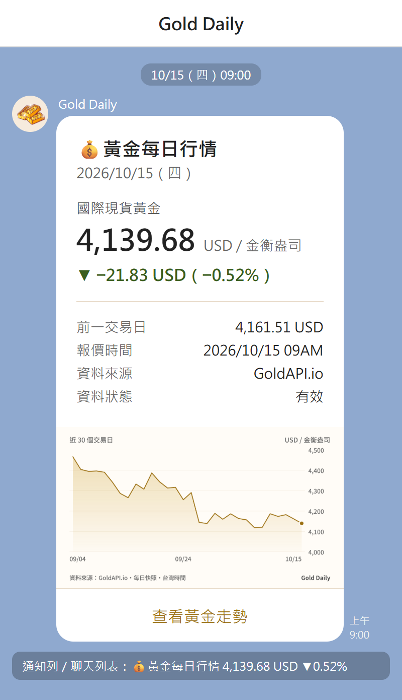
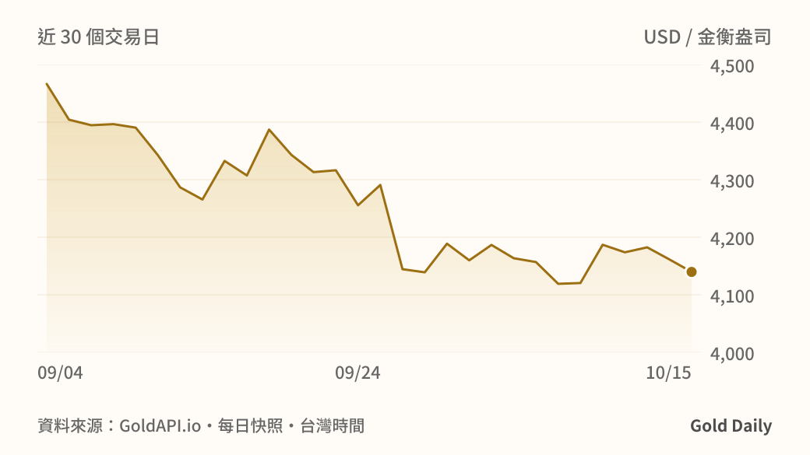
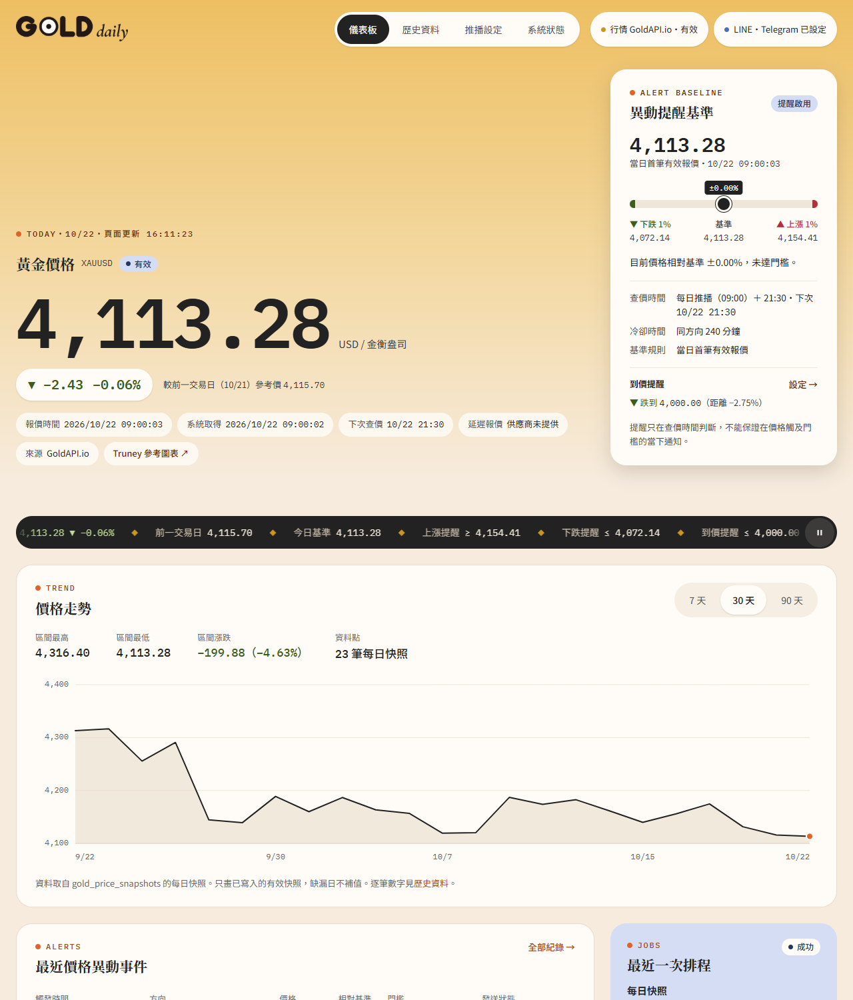
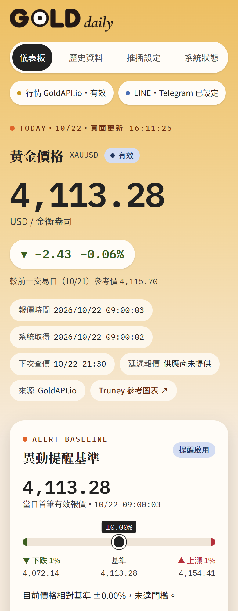
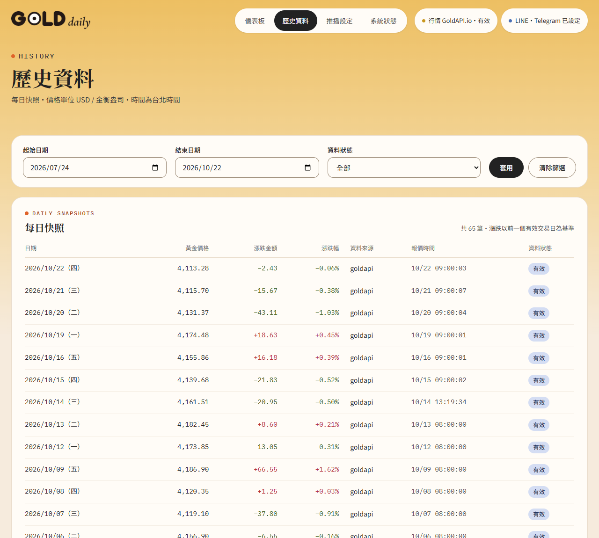
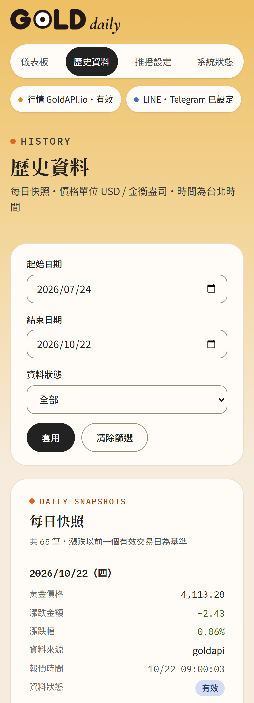
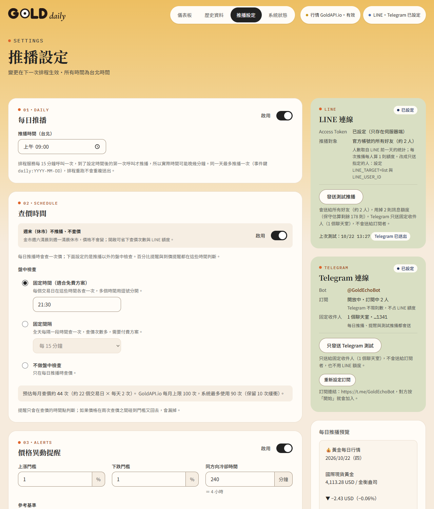
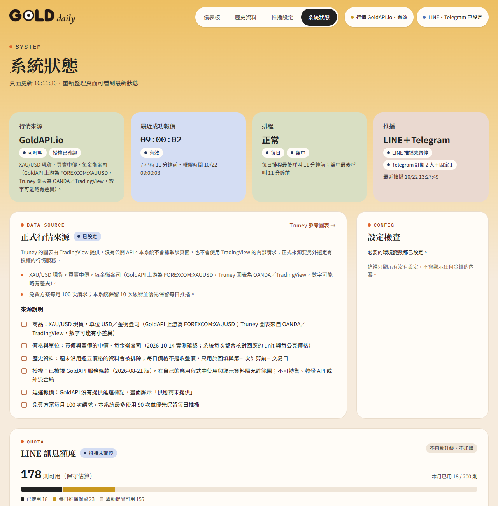
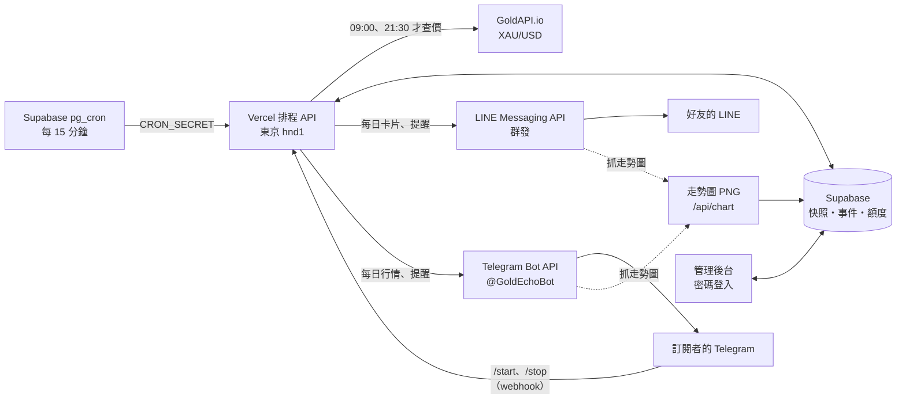

<p align="center">
  
</p>

<h1 align="center">Gold Daily</h1>

<p align="center">
  每個交易日早上 9 點，把國際金價送到 LINE 和 Telegram。<br>
  金金計較，天天報到。黃金價格追蹤與推播工具。
</p>

<p align="center">
  <a href="#line-推播">LINE 推播</a> ・
  <a href="#telegram-推播">Telegram 推播</a> ・
  <a href="#管理後台">管理後台</a> ・
  <a href="#功能">功能</a> ・
  <a href="#運作方式">運作方式</a> ・
  <a href="#技術與費用">技術與費用</a> ・
  <a href="web/README.md">安裝與部署</a>
</p>

---

## LINE 推播

<table>
  <tr>
    <td width="46%" valign="top">
      
    </td>
    <td valign="top">

**每日行情卡片**（每個交易日 09:00）

- 國際現貨黃金的最新價格（USD／金衡盎司）
- 漲跌金額與幅度，跟前一交易日比較：**漲紅、跌綠**
- 前一交易日價格、報價時間、資料來源、資料狀態
- 卡片裡附「近 30 個交易日」走勢圖，點圖可以放大
- 「查看黃金走勢」按鈕開啟 Truney 金價圖
- 通知列與聊天列表顯示一行摘要：<br>`💰黃金每日行情 4,139.68 USD ▼0.52%`

**提醒**（純文字）

- 🔔 **價格異動提醒**：比當天基準漲跌 ≥ 1%（門檻與冷卻時間可調）
- 🎯 **到價提醒**：漲到或跌到目標價時通知一次，之後自動關閉；同時達到好幾個目標價只推最接近目前價格的那一個

預設群發給官方帳號的所有好友，加好友就會收到；也可以改成只送指定的人。

<sub>左圖依實際推播的卡片內容排版（2026/10/15 的真實數字），LINE 上的字型與間距以手機為準。</sub>

</td>
  </tr>
</table>

走勢圖由網站自己產生，只用資料庫裡的每日快照，不會多查價：

<p align="center">
  
</p>

---

## Telegram 推播

**訂閱：在 Telegram 搜尋 [@GoldEchoBot](https://t.me/GoldEchoBot)，按「開始」就加入，完全免費；傳 `/stop` 隨時取消。**

**每日行情**（每個交易日 09:00，跟 LINE 同一時間）

- 跟 LINE 卡片一樣是說明文字在上、近 30 個交易日走勢圖在下，最下面有「查看黃金走勢」按鈕
- 說明文字有價格、漲跌（加粗）、前一交易日、報價時間與資料來源；Telegram 不能幫文字上色，所以沒有漲紅跌綠

**提醒**：價格異動提醒與到價提醒，跟 LINE 同步送出（純文字，標題加粗）。

**收件人**：所有訂閱者，加上管理者在 `TELEGRAM_CHAT_ID` 指定的固定收件人（自己、群組或頻道）。測試推播只送固定收件人，不會打擾訂閱者。封鎖 bot 的人會自動標成「無法傳送」，不再傳送。

**費用**：Telegram Bot API 免費、不限則數，不占 LINE 額度；訂閱的人再多，GoldAPI 的查價次數也不會增加。

### 推廣素材

風格：芥末黃紙紋底、奶油色書頁、扁平手繪小人、明朝體大標。圖的原始檔是 [`design/promo/promo.html`](design/promo/promo.html)、影片是 [`design/promo/video.html`](design/promo/video.html)（都可以直接用瀏覽器打開預覽），logo 與插畫共用 [`design/promo/art.js`](design/promo/art.js)。執行 `bash design/promo/render.sh` 會用本機的 Chrome 輸出 PNG 到 `design/promo/png/`；`node design/promo/render-video.mjs` 輸出影片到 `design/promo/out/`（需要 ffmpeg）。圖檔與影片都不進版控，需要時重新產生。

| 輸出檔 | 尺寸 | 用途 | Slogan |
|---|---|---|---|
| `square.png` | 1080×1080 | LINE、IG、Telegram 貼文 | 金金計較，天天報到。 |
| `story.png` | 1080×1920 | 限時動態 | 早安，今天的金價來囉。 |
| `banner.png` | 1200×630 | 分享連結預覽、社團貼文 | 金價不用盯，金條幫你報。 |
| `avatar.png` | 640×640 | Telegram bot 大頭貼 | — |
| `intro.png` | 640×360 | Telegram bot 介紹圖（還沒按「開始」時看到） | 金金計較，天天報到。 |
| `logo-clear.png`、`logo-mustard.png` | — | logo（透明底、芥末底） | — |
| `out/gold-daily-story.mp4` | 1080×1920，12 秒 | 限時動態、Reels、Telegram／LINE 影片（無聲，可在發文時加音樂） | 早安，今天的金價來囉。 |

影片的順序：logo 一筆一畫寫出來（金幣 O 從上方掉下來）→ 縮到上方、標題跳出 → 紙張滑上來、手機落下、走勢圖畫出來 → 小人出現、金條一根根掉下來疊好 → Subscribe、`@GoldEchoBot` 與 QR code。插畫的毛邊會輕微晃動，像手繪動畫；最後一格跟 `story.png` 一樣。

貼文、限時動態、橫幅與影片都附 `@GoldEchoBot` 與訂閱 QR code（連到 `https://t.me/GoldEchoBot`），也都註明「價格僅供參考，不構成投資建議」。備選 slogan：「讓金價自己來找你」「漲了跌了，第一個告訴你」「每天一則，金價心裡有數」。bot 的大頭貼、介紹圖與說明文字怎麼設定，見 [web/README.md 的 Telegram 設定](web/README.md#推廣素材與-bot-設定)。

---

## 管理後台

用密碼登入的網站，桌機與手機都能用。以下截圖都是正式環境的真實資料。

### 儀表板

<table>
  <tr>
    <td width="70%"></td>
    <td></td>
  </tr>
</table>

最新金價與漲跌、下次查價時間、異動提醒的基準與門檻（目前價格落在哪裡一眼就看得到）、到價提醒、近 7／30／90 天走勢、最近的提醒事件與排程結果。

### 歷史資料

<table>
  <tr>
    <td width="70%"></td>
    <td></td>
  </tr>
</table>

每個交易日一筆快照，可依日期與資料狀態篩選；沒取得有效報價的日子會明確標示，不補假資料。手機上表格自動改成一筆一張卡片，不用橫向滑動。

### 推播設定



推播時間、盤中檢查時間、漲跌門檻與冷卻時間、基準規則、LINE 方案與安全緩衝、到價提醒。右側是每日推播預覽（含走勢圖），可以按「發送測試推播」看 LINE 上的實際樣子。設定 Telegram 後另有「Telegram 連線」卡片（開放訂閱、只發送 Telegram 測試、訂閱連結）與「Telegram 訂閱者」清單（可以移除）。

### 系統狀態



行情來源、最近一次報價、排程是否正常、LINE 與 Telegram 推播狀態（含訂閱人數）、設定檢查（只顯示有沒有設定，不顯示金鑰）、LINE 額度（已用／每日推播保留／提醒可用），以及排程執行紀錄與通知事件（失敗可重試）。

---

## 功能

| | |
|---|---|
| **每日推播** | 交易日 09:00 查價、存快照、送出每日卡片；週末休市不推播 |
| **盤中檢查** | 預設 21:30 再查一次，判斷異動提醒與到價提醒（也可改成固定間隔或關閉） |
| **推播對象** | 預設群發給官方帳號所有好友；可改成只送指定的 User ID 名單 |
| **Telegram 推播** | 每日推播與提醒同時送到 Telegram（[@GoldEchoBot](https://t.me/GoldEchoBot)）；任何人私訊 bot 傳 `/start` 就訂閱、`/stop` 取消，也可以指定固定收件人（自己、群組或頻道）。每日行情跟 LINE 卡片一樣文字在上、走勢圖在下，附「查看黃金走勢」按鈕。兩邊分開記錄，一邊失敗不影響另一邊 |
| **LINE 額度保護** | 依 LINE 官方用量與推播人數計算，優先保留每日推播的份量；不夠送給所有人就整則不送；不會自動升級或加購 |
| **行情額度保護** | GoldAPI 免費方案每月 100 次，系統最多用 90 次並優先保留每日推播 |
| **不重複推播** | 每則事件有唯一的事件鍵，重試沿用 LINE retry key、Telegram 記下已送達的聊天室；排程重跑、系統重啟都不會重複送出 |
| **資料誠實** | 漲跌都來自實際資料；缺前一交易日就寫「暫無有效資料」，過期或模擬資料一律明確標示 |
| **報價狀態** | 依查價時間表判斷是否最新：兩次查價之間顯示「有效」與下次查價時間，只有來源沒更新或排程漏查才標示過期 |
| **管理後台** | 密碼登入；儀表板、歷史資料、推播設定、系統狀態；手機版表格自動改成卡片 |

---

## 運作方式



1. Supabase 的 pg_cron 每 15 分鐘呼叫網站的排程 API。大多數時候還沒到時間，API 直接回「未到期」，不會用掉查價次數。
2. 到了推播或檢查時間，向 GoldAPI 取得 XAU/USD 報價，驗證後存成快照，算出跟前一交易日的漲跌。
3. 組成每日卡片（或提醒），檢查 LINE 剩餘額度夠送給所有人後送出；同時送到 Telegram 的訂閱者與固定收件人。兩邊的結果分開記錄在資料庫，失敗會重試。
4. 卡片裡的走勢圖由網站即時產生，LINE 與 Telegram 的伺服器直接來抓。
5. 使用者對 bot 傳 `/start`、`/stop` 時，Telegram 透過 webhook 通知網站，更新訂閱名單。

---

## 技術與費用

| | 使用 | 費用 |
|---|---|---|
| 網站 | Next.js 16（App Router）、TypeScript、Tailwind CSS 4，部署在 Vercel（東京） | Hobby 免費 |
| 資料庫與排程 | Supabase（Postgres、pg_cron、pg_net、Vault，東京） | 免費方案 |
| 行情來源 | GoldAPI.io（XAU/USD 現貨，買賣中價） | 免費方案，每月 100 次 |
| 推播 | LINE Messaging API（官方帳號，Flex Message 卡片） | 輕用量免費，每月 200 則 |
| 推播（選用） | Telegram Bot API（`sendPhoto`／`sendMessage`） | 免費，不限則數 |
| 走勢圖 | `next/og` 產生 PNG，字型為 Noto Sans TC 子集（SIL OFL） | — |
| 測試 | Vitest，230 個測試；不連真的 LINE、Telegram、Supabase 或行情來源 | — |

LINE 依收件人數計算額度：2 個人時，每日推播一個月約 42～44 則，就算每天都觸發提醒，最多也約 84～88 則，都在 200 則以內。

---

## 專案結構

```
gold-daily/
├── web/            Next.js 應用程式（說明、環境變數、部署見 web/README.md）
│   ├── src/app/    頁面與 API（排程、走勢圖、LINE 與 Telegram webhook）
│   ├── src/lib/    行情來源、排程工作、LINE、Telegram、資料存取、額度保護
│   └── supabase/   資料表 migration 與 pg_cron 排程 SQL
├── design/         視覺設計稿（純 HTML，直接用瀏覽器開 design/index.html）
│   └── promo/      logo、推廣圖與推廣影片的原始檔、輸出腳本（輸出到 png/、out/，不進版控）
└── docs/images/    README 的截圖
```

## 安裝與部署

環境變數、Supabase migration、pg_cron 排程、LINE 官方帳號與 Telegram bot 設定、Vercel 部署步驟，都在 **[web/README.md](web/README.md)**。
